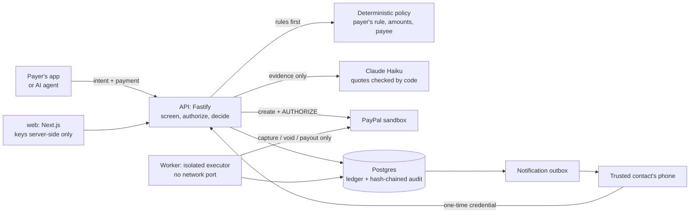

# Second Key

**An AI agent can be manipulated. Your money shouldn't be.** Second Key checks what an agent is about to buy against what the person actually authorized, using facts it fetched itself, before PayPal moves any money. The same layer protects people paying under pressure: you set a rule while you're calm. When a payment matches it, PayPal reserves the money and only the person you trust can let it go ahead. You can't approve it yourself, so neither can someone coaching you.

Second Key is a safety layer that wallets, marketplaces and AI-agent platforms build into their payment flow, on PayPal. It pauses a payment between the decision to pay and the money moving. A deterministic policy decides whether it pauses. AI only adds evidence. An isolated executor is the only code that can move money, and every outcome is read back from PayPal.

> **Live demo:** https://witness-web.onrender.com · everything runs on the **PayPal sandbox** with synthetic people. No real money moves.

## For judges: five minutes, no setup

1. **[Payer demo](https://witness-web.onrender.com/pay).** You play Rose.
   - Set her rule (first payments of $500+ to someone new) and enrol Sarah. Sarah's phone opens in its own window and accepts there.
   - Send $1,800 after an urgent "grandson" call. It pauses: PayPal shows the money reserved, and Rose can remind Sarah or cancel, but **can't approve**.
   - In Sarah's window, open the request, see the exact payee, amount and quoted evidence, and decide. PayPal confirms the outcome.
   - A call from "the bank" asks for $450 to a "protected account". That's below Rose's rule, so only the evidence can pause it: the AI quotes the safe-account and install-this-app lines, and the payment waits for Sarah.
   - The contractor's invoice to someone Rose has paid before goes straight through.
2. **[Agent demo](https://witness-web.onrender.com/agent), on real AP2 mandates.** Your browser plays Rose's device: a WebCrypto key generated there signs her AP2 open mandates (a Ridgeline trail runner, size 10, not white, up to $90). A scripted agent closes them, Second Key verifies them, and a conforming payment is bound to PayPal's own order. Five runs, and a ladder shows which check stopped each one:
   - **it goes right:** every check passes and PayPal captures;
   - **agent steered** to a $480 shoe: refused by AP2's own constraints (not listed, over the cap), before PayPal is called;
   - **wrong colour:** the white shoe is on Rose's list, so AP2's checks accept it. Second Key's facts, fetched and signed by Second Key, say "Cloud White", and refuse it;
   - **checkout swaps it:** the mandates conform, but PayPal's stored order holds another shoe, so it's voided before capture;
   - **mandate reused:** the second use of the same mandate is refused by Second Key's ledger.

   Every receipt opens and verifies in the browser against the published key set.

   **Then try it with real products** (same page, "Now try it with real products"):
   1. Type what Rose wants, e.g. "a gold smartwatch under $150". Claude Haiku drafts the search, the colour rule and the budget; you see them and can change them before anything is signed.
   2. Channel3 returns real products from real retailers.
   3. Rose's device signs an AP2 mandate: the agent's top results as her list, her rules as Second Key's constraint, her budget.
   4. Let the agent (Haiku) choose, or make it buy any product you click. Second Key re-fetches that product from Channel3 by id, signs the facts it relies on, verifies, and settles on the PayPal sandbox.

   Each way an agent goes wrong has its own outcome:
   - **a listed product that isn't gold:** AP2 says yes, Second Key's facts say no;
   - **a listing that doesn't state its colour:** Second Key can't confirm it, so it isn't paid;
   - **a product off the list:** AP2's own constraints refuse it;
   - **the checkout sends PayPal a different real product:** voided at PayPal before capture;
   - **the agent hides Rose's list** by withholding its disclosures: the signature still verifies, but the list matches nothing, so it's refused. A verifier that reads an empty list as "anything" would accept this purchase.
3. **[Protection Desk](https://witness-web.onrender.com/desk)** (AG Grid and AG Studio, no sign-in).
   - **Incidents:** every intervention in an AG Grid, with what the AI observed, which rule decided it, who decided it and what PayPal says as separate columns, and the audit chain verified per incident.
   - **Agent mandates · AP2:** every agent purchase under an AP2 mandate, one AG Grid row each, with the layers as columns: signatures and AP2 constraints (what any AP2 verifier checks), Second Key's facts and ledger, then PayPal's order and the money. A headline counts the purchases **AP2 alone would have said yes to**. Open a row for the reasons, the PayPal order and capture IDs, and receipts you can verify.
   - **Insights:** an AG Studio dashboard in Second Key's own theme (typography, palette, cards, scrollbars), reading top to bottom: headline numbers, then **Where agents were stopped**, a custom widget that shows every AP2 agent purchase by the layer that decided it and brackets what AP2 alone would have allowed. It reads Studio's own data engine, so filters apply, and clicking a layer cross-filters the whole dashboard. Then who decided paused payments, the pressure patterns, the custom proof-chain widget (AI → rule → person → PayPal, audit chain verified live) and both tables. On tablets and phones the layout stacks and the AI panel starts collapsed.
   - **Ask the Second Key agent:** a custom lead and analyst built on the Studio Agent Framework, working with Studio's built-in agents on Claude Haiku. Try "Who decided the paused payments?" or "What did AP2 alone miss?". It is read-only, with its own small spend cap.
4. **[Developers](https://witness-web.onrender.com/developers).**
   - **Run a test verification**, with no account and no key. Your browser signs sample AP2 mandates with a throwaway key, Second Key's real verifier checks them, and your browser verifies the signed receipts against `/.well-known/jwks.json`. Nothing is stored and PayPal isn't called.
   - **Constraint templates as JSON:** one exact item, a monthly purchase with a budget, and a two-person rule.
   - **A conformance suite** of eleven real sandbox payments, each checked against PayPal's own record and its audit chain. Among them is the **cart swap**: the agent's cart is right, but the order PayPal receives isn't, and Second Key voids it before capture.
5. **[Try the analysis](https://witness-web.onrender.com/try)** on your own text. You see what the AI observed, with the exact words, kept separate from what the fixed policy does.

## How it works



- **The payer's rule triggers the pause, not the AI.** The rule is a standing profile set in advance: a threshold for first payments to someone new, plus a trusted contact. Tightening applies at once. Loosening it, or replacing the contact, takes 48 hours, and the current contact is told. "First payment" comes from recorded captured payments, never from the request's own claim. ([ADR-0019](docs/decisions/0019-payer-rule-and-optional-evidence.md), [ADR-0020](docs/decisions/0020-out-of-band-second-key.md))
- **The second key is held by someone else.** Only a credential minted on the trusted contact's own channel can approve a paused payment. It is stored only as a hash, bound to one payment and one contact, and dies when the contact is replaced or revoked. Neither the payer's app nor an admin can approve. The payer can always cancel.
- **AI adds evidence, never approval.** If the payer shares the conversation, Claude Haiku reports pressure tactics with quotes that code verifies appear in the source. AI output can only add a pause. A model failure holds the payment and is labelled a technical failure, not a finding.
- **PayPal's own order is the check.** Before every capture, Second Key re-reads the order from PayPal and requires the exact items, amount, currency and payee it approved. Order status alone never counts as payment.
- **Money moves only in the executor.** A worker with no network port consumes single-use approvals, with deterministic PayPal request IDs. The API has no capture or void route, and a test enforces this.
- **Everything is evidence.** Each decision names who made it, and every step goes into an append-only, hash-chained audit log.
- **AP2 mandates, verified, then settled.** Second Key is an AP2 delegated verifier ([ADR-0023](docs/decisions/0023-ap2-delegated-verifier.md)): SD-JWT delegation chains, AP2's canonical schemas, and every standard constraint.
  - **Two constraints of its own:** attributes checked against facts it fetches and signs, and a co-signature above a threshold.
  - **One ledger across merchants** for single use, budgets and recurrence.
  - **Settlement binding:** a conforming payment is captured only if PayPal's stored order holds exactly the verified checkout.
  - **Signed receipts** that anyone can check against `GET /.well-known/jwks.json`. API: `POST /v2/verifications`, `POST /v2/settlements`.

More: [architecture](docs/architecture.md) · [threat model](docs/threat-model.md) · [AI design](docs/ai-design.md) · [decisions](docs/decisions/) · [OpenAPI](docs/openapi.yaml) · [Postman](postman/witness.postman_collection.json)

## Results (measured, not claimed)

| What | Result |
|---|---|
| Second-key invariant | 24 API tests: the payer and admin can't approve; the payer's key can't read the contact's inbox; credentials die on reminder, replacement or revocation; the revocation-versus-approval race leaves exactly one outcome ([tests](apps/api/test/guardian.db.test.ts)) |
| Agent-purchase scenarios on the real sandbox, checked against PayPal's state | 7/7 ([evidence](docs/evidence/stage4-remediation-sandbox-run.md)) |
| Agent decision benchmark, 76 cases × 3 runs, live Haiku | 0 false captures in 165 runs where capture was forbidden; clean purchases held 7.1% ([report](evals/report/latest.md)) |
| Manipulation detection, self-authored synthetic set | 46/46 scams flagged, 0/30 benign flagged, every quote verbatim ([report](secondkey/reports/s1-v1.md)) |
| Captures without a consumed approval | **0**, computed from the database and shown live on the developer page |
| AP2 interop with Google's reference SDK (commit `e1ea56d`) | Both directions: SDK-built chains verify here; ours, receipts included, verify there. The spec's example tokens recompute ([interop](packages/ap2/interop/README.md)) |
| AP2 constraints vs the reference SDK, 15 shared cases | 11 agree; 4 differ where we follow the spec text, each case citing it ([interop](packages/ap2/interop/README.md)) |
| AP2 settlement on the real sandbox, checked against PayPal's order | 4/4: exact order captured; cart swap and double quantity voided, nothing captured; replay and second order refused ([evidence](docs/evidence/ap2-settlement-sandbox-run.md)) |
| AP2 verifier, ledger and settlement tests | 175 (137 unit, 38 on Postgres). All 39 deliberate breaks of their rules were caught by the tests |

## Honest limits

- **Sandbox only.** The PayPal host is pinned in code ([ADR-0001](docs/decisions/0001-sandbox-only-host-guard.md)).
- **Platform-held transfers.** A transfer is an authorization to the Second Key demo merchant, then a capture and a PayPal Payout. Second Key can't intercept PayPal Friends & Family or other apps; it protects payments in platforms that build it in.
- **Enrolment proves a channel, not a person.** In the demo, a separate window stands in for the contact's phone. It proves the API boundary, not channel security. Production needs a verified SMS or email channel.
- **What it doesn't stop:** splitting payments below the threshold, paying a payee already paid, or paying through another app.
- **The evaluation sets are self-authored.** That is not independent validation; `/try` invites more.
- **AG Studio runs in trial mode** (watermark) unless a licence key is set. The public agent shares one small per-process budget; when it runs out, it says so.
- **AP2: interop, not certification.** "Compatible" here means it verifies chains Google's reference SDK builds and builds chains it accepts, for the shapes tested.
  - A caller sends the keys it trusts with each verification; receipts name the key thumbprints relied on.
  - Without `SECONDKEY_RECEIPT_JWK`, receipts are signed with a per-process key and stop verifying after a restart.
  - In the agent demo, the shopping agent and merchant are scripted server-side parties.

## Run it locally

Requirements: Node 24, pnpm 10.33, and PayPal sandbox credentials (Vault enabled). An Anthropic key is optional; without it every AI check fails closed and payments hold.

```bash
pnpm install
cp .env.example .env              # PayPal sandbox values; ANTHROPIC_API_KEY optional
pnpm db:dev                       # embedded Postgres (another terminal)
pnpm db:migrate && pnpm db:seed   # writes .witness/dev-keys.json, prints the demo payer id
# put WITNESS_DEMO_SHOPPER_ID and the ops/demo/shopper keys into .env (see .env.example)
pnpm api                          # http://127.0.0.1:4000
pnpm worker
pnpm --filter @witness/web build && pnpm --filter @witness/web start   # http://127.0.0.1:3000
```

| Command | What it does |
|---|---|
| `pnpm typecheck` | Type checks |
| `pnpm deps:check` | Import rules that make capture isolation structural |
| `pnpm test` | Unit and database tests (fake PayPal, fake model) |
| `pnpm eval` | Live benchmark; refuses to start if the worst case exceeds $1 |
| `pnpm tsx scripts/ap2-sandbox-settlement.ts` | AP2 settlement on the real PayPal sandbox; writes `docs/evidence/ap2-settlement-sandbox-run.md` |

**Deploy:** Render Blueprint ([`render.yaml`](render.yaml)): API, worker, web, Postgres and a shared env group. See [docs/deploy-render.md](docs/deploy-render.md).

## Built with

- **PayPal:** Orders v2 with vaulted, buyer-not-present AUTHORIZE; Payments (capture, void); Payouts; Webhooks; Disputes.
- **AG Grid:** the Protection Desk's incident grid (AG Grid Community) and its Insights (AG Studio: custom widget, theming, and the Studio Agent Framework with Haiku swapped in).
- **Anthropic Claude Haiku:** evidence analysis, prompt-injection and listing checks, the intent compiler, and the Studio agent.
- **AP2 (Agent Payments Protocol v0.2):** mandates as SD-JWT (RFC 9901) delegation chains, verified in TypeScript with `jose` and checked for interop against Google's reference SDK.
- **Channel3:** product search for the agent (`POST /v1/search`), and the independent product facts Second Key re-fetches by id (`GET /v1/products/{id}`) and signs before deciding. Colour comes from the listing's own variant, else its title, else a description that states one colour, and the facts record which. **Render:** hosting.
- TypeScript, Fastify, Next.js, Postgres, pg-boss, Drizzle, Zod, Vitest.

The internal package names (`@witness/*`) date from the project's first phase, an agent spend-control prototype that is now the agent side of Second Key.

MIT licence.
