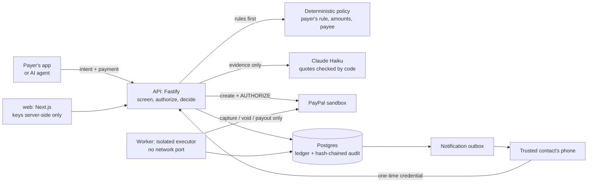

# Second Key

**A second key for payments made under pressure.** You set a rule while you're calm. When a payment matches it, PayPal reserves the money and only the person you trust can let it go ahead. You can't approve it yourself, so neither can someone coaching you.

Second Key is a safety layer that wallets, marketplaces and AI-agent platforms build into their payment flow, on PayPal. It pauses a payment between the decision to pay and the money moving. A deterministic policy decides whether it pauses. AI only adds evidence. An isolated executor is the only code that can move money, and every outcome is read back from PayPal.

> **Live demo:** https://witness-web.onrender.com · everything runs on the **PayPal sandbox** with synthetic people. No real money moves.

## For judges: five minutes, no setup

1. **[Payer demo](https://witness-web.onrender.com/pay).** You play Rose.
   - Set her rule (first payments of $500+ to someone new) and enrol Sarah. Sarah's phone opens in its own window and accepts there.
   - Send $1,800 after an urgent "grandson" call. It pauses: PayPal shows the money reserved, and Rose can remind Sarah or cancel, but **can't approve**.
   - In Sarah's window, open the request, see the exact payee, amount and quoted evidence, and decide. PayPal confirms the outcome.
   - A call from "the bank" asks for $450 to a "protected account". That's below Rose's rule, so only the evidence can pause it: the AI quotes the safe-account and install-this-app lines, and the payment waits for Sarah.
   - The contractor's invoice to someone Rose has paid before goes straight through.
2. **[Agent demo](https://witness-web.onrender.com/agent).** An AI agent can be fooled; the money can't. Four runs, each caught at a different step, shown field by field (what Rose confirmed, the agent's cart, PayPal's stored order):
   - a page tells the agent a $480 shoe was pre-approved and it buys it: refused on Rose's budget before PayPal is called;
   - the agent ignores the trap but bought from a page giving orders to agents: paused for Rose;
   - the checkout sends PayPal a different shoe at the same price: caught on PayPal's own order and voided before capture;
   - an ordinary page: completes.

   Then write your own product page and see whether it gets past the screening.
3. **[Protection Desk](https://witness-web.onrender.com/desk)** (AG Grid and AG Studio, no sign-in).
   - **Incidents:** every intervention in an AG Grid, with what the AI observed, which rule decided it, who decided it and what PayPal says as separate columns, and the audit chain verified per incident.
   - **Insights:** an AG Studio dashboard over the same rows, in Second Key's theme, with a custom proof-chain widget (AI → rule → person → PayPal, audit chain verified live).
   - **Ask the Second Key agent:** a custom lead and analyst built on the Studio Agent Framework, working with Studio's built-in agents on Claude Haiku. Try "Who decided the paused payments?". It is read-only, with its own small spend cap.
4. **[Developers](https://witness-web.onrender.com/developers).** A conformance suite of eleven real sandbox payments, each checked against PayPal's own record and its audit chain. Among them is the **cart swap**: the agent's cart is right, but the order PayPal receives isn't, and Second Key voids it before capture.
5. **[Try the analysis](https://witness-web.onrender.com/try)** on your own text. You see what the AI observed, with the exact words, kept separate from what the fixed policy does.

## How it works



- **The payer's rule triggers the pause, not the AI.** The rule is a standing profile set in advance: a threshold for first payments to someone new, plus a trusted contact. Tightening applies at once. Loosening it, or replacing the contact, takes 48 hours, and the current contact is told. "First payment" comes from recorded captured payments, never from the request's own claim. ([ADR-0019](docs/decisions/0019-payer-rule-and-optional-evidence.md), [ADR-0020](docs/decisions/0020-out-of-band-second-key.md))
- **The second key is held by someone else.** Only a credential minted on the trusted contact's own channel can approve a paused payment. It is stored only as a hash, bound to one payment and one contact, and dies when the contact is replaced or revoked. Neither the payer's app nor an admin can approve. The payer can always cancel.
- **AI adds evidence, never approval.** If the payer shares the conversation, Claude Haiku reports pressure tactics with quotes that code verifies appear in the source. AI output can only add a pause. A model failure holds the payment and is labelled a technical failure, not a finding.
- **PayPal's own order is the check.** Before every capture, Second Key re-reads the order from PayPal and requires the exact items, amount, currency and payee it approved. Order status alone never counts as payment.
- **Money moves only in the executor.** A worker with no network port consumes single-use approvals, with deterministic PayPal request IDs. The API has no capture or void route, and a test enforces this.
- **Everything is evidence.** Each decision names who made it, and every step goes into an append-only, hash-chained audit log.

More: [architecture](docs/architecture.md) · [threat model](docs/threat-model.md) · [AI design](docs/ai-design.md) · [decisions](docs/decisions/) · [OpenAPI](docs/openapi.yaml) · [Postman](postman/witness.postman_collection.json)

## Results (measured, not claimed)

| What | Result |
|---|---|
| Second-key invariant | 22 API tests: the payer and admin can't approve; the payer's key can't read the contact's inbox; credentials die on reminder, replacement or revocation; the revocation-versus-approval race leaves exactly one outcome ([tests](apps/api/test/guardian.db.test.ts)) |
| Agent-purchase scenarios on the real sandbox, checked against PayPal's state | 7/7 ([evidence](docs/evidence/stage4-remediation-sandbox-run.md)) |
| Agent decision benchmark, 76 cases × 3 runs, live Haiku | 0 false captures in 165 runs where capture was forbidden; clean purchases held 7.1% ([report](evals/report/latest.md)) |
| Manipulation detection, self-authored synthetic set | 46/46 scams flagged, 0/30 benign flagged, every quote verbatim ([report](secondkey/reports/s1-v1.md)) |
| Captures without a consumed approval | **0**, computed from the database and shown live on the developer page |

## Honest limits

- **Sandbox only.** The PayPal host is pinned in code ([ADR-0001](docs/decisions/0001-sandbox-only-host-guard.md)).
- **Platform-held transfers.** A transfer is an authorization to the Second Key demo merchant, then a capture and a PayPal Payout. Second Key can't intercept PayPal Friends & Family or other apps; it protects payments in platforms that build it in.
- **Enrolment proves a channel, not a person.** In the demo, a separate window stands in for the contact's phone. It proves the API boundary, not channel security. Production needs a verified SMS or email channel.
- **What it doesn't stop:** splitting payments below the threshold, paying a payee already paid, or paying through another app.
- **The evaluation sets are self-authored.** That is not independent validation; `/try` invites more.
- **AG Studio runs in trial mode** (watermark) unless a licence key is set. The public agent shares one small per-process budget; when it runs out, it says so.

## Run it locally

Requirements: Node 24, pnpm 10.33, and PayPal sandbox credentials (Vault enabled). An Anthropic key is optional; without it every AI check fails closed and payments hold.

```bash
pnpm install
cp .env.example .env              # PayPal sandbox values; ANTHROPIC_API_KEY optional
pnpm db:dev                       # embedded Postgres (another terminal)
pnpm db:migrate && pnpm db:seed   # writes .witness/dev-keys.json, prints the demo payer id
# put WITNESS_DEMO_SHOPPER_ID and the ops/demo/shopper keys into .env (see .env.example)
pnpm api                          # http://127.0.0.1:4000
pnpm worker
pnpm --filter @witness/web build && pnpm --filter @witness/web start   # http://127.0.0.1:3000
```

| Command | What it does |
|---|---|
| `pnpm typecheck` | Type checks |
| `pnpm deps:check` | Import rules that make capture isolation structural |
| `pnpm test` | Unit and database tests (fake PayPal, fake model) |
| `pnpm eval` | Live benchmark; refuses to start if the worst case exceeds $1 |

**Deploy:** Render Blueprint ([`render.yaml`](render.yaml)): API, worker, web, Postgres and a shared env group. See [docs/deploy-render.md](docs/deploy-render.md).

## Built with

- **PayPal:** Orders v2 with vaulted, buyer-not-present AUTHORIZE; Payments (capture, void); Payouts; Webhooks; Disputes.
- **AG Grid:** the Protection Desk's incident grid (AG Grid Community) and its Insights (AG Studio: custom widget, theming, and the Studio Agent Framework with Haiku swapped in).
- **Anthropic Claude Haiku:** evidence analysis, prompt-injection and listing checks, the intent compiler, and the Studio agent.
- **Channel3:** independent product facts for agent purchases. **Render:** hosting.
- TypeScript, Fastify, Next.js, Postgres, pg-boss, Drizzle, Zod, Vitest.

The internal package names (`@witness/*`) date from the project's first phase, an agent spend-control prototype that is now the agent side of Second Key.

MIT licence.
