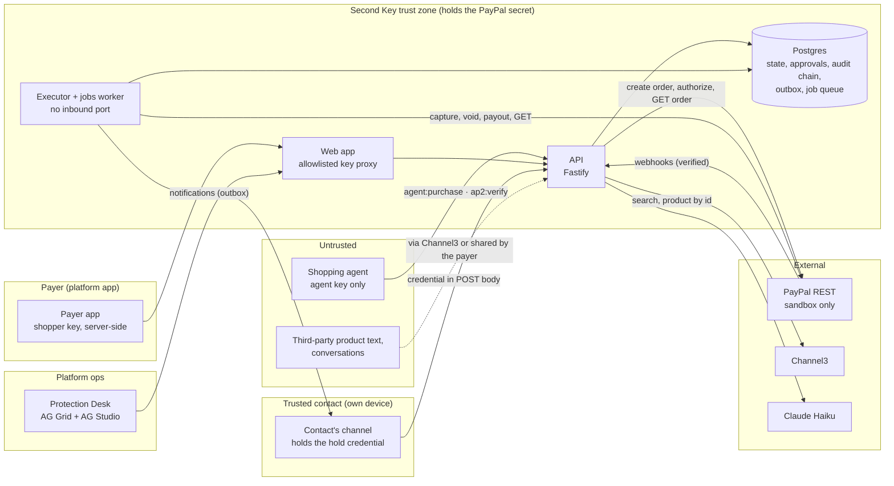
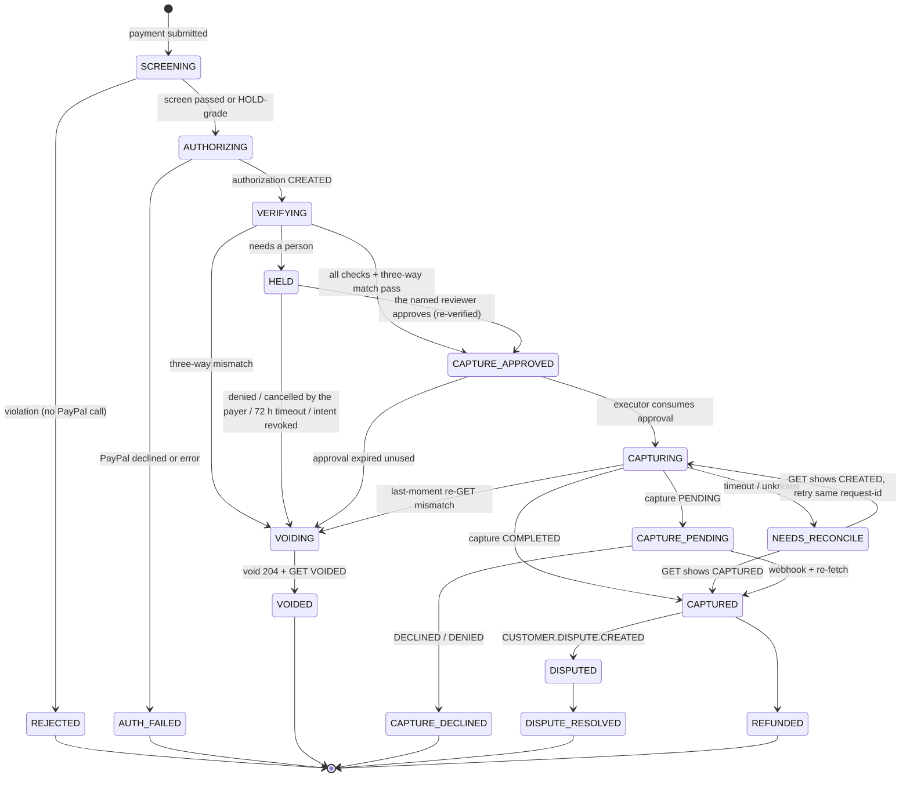
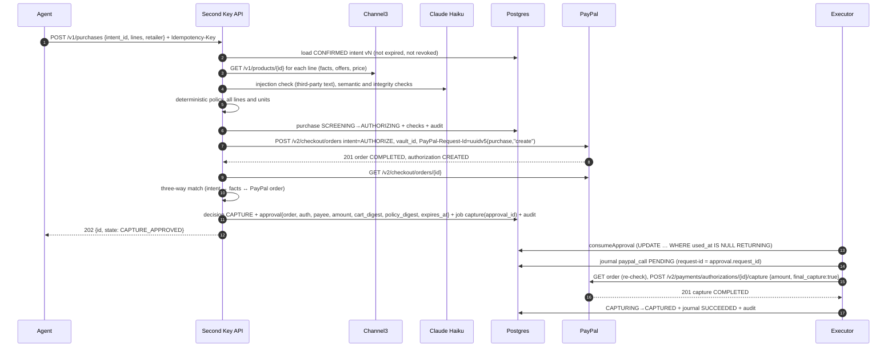
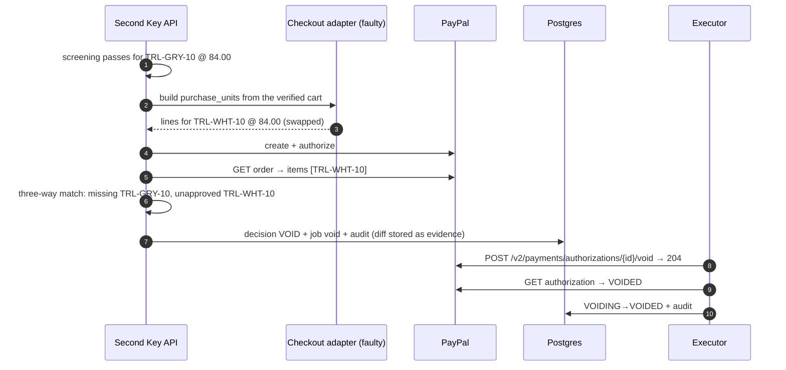

# Second Key architecture

Status: **current** · updated 2026-11-10 · Decisions referenced as ADR-NNNN live in `docs/decisions/`. Internal identifiers (package names such as `@witness/*`, `WITNESS_*` environment variables, Render service names) keep the project's original code name; nothing user-facing does.

## 1. Shape of the system in one paragraph

Second Key sits **between a payment decision and PayPal**, inside a platform that takes payments for people and for their AI agents. A person confirms an **intent**: what an agent may buy (category, budget, retailers, hard rules), or exactly whom to pay and how much. An agent or app submits a **payment** against that intent. Second Key re-fetches product **facts** itself, screens the payment with fixed rules plus AI checks that can only add caution, creates the PayPal order **from its own verified cart**, authorizes it against the payer's saved wallet, re-reads the order from PayPal, and decides CAPTURE, HOLD or VOID. A hold is released only by the person the hold names: the payer for their own agent's purchase, or the payer's **trusted contact** (the "second key") for a transfer their own rule paused. Money moves only in an isolated **executor** with no inbound port, and only by consuming a single-use **approval** bound to the exact order, authorization, payee, amount and cart. Every transition is written to a hash-chained audit log in the same database transaction. For agents that carry **AP2 mandates**, the same engine acts as a delegated verifier and binds a conforming payment to PayPal's order before capture.

## 2. Components and trust boundaries



| Zone | Holds | Can do | Cannot do |
|---|---|---|---|
| Agent | A key with `agent:purchase` (and/or `ap2:verify`) | Read a confirmed intent; submit a payment; read its own purchases; present AP2 mandates | Create or edit intents; approve holds; call PayPal (it has no credentials) |
| Payer app | A `shopper` key, server-side | Create, confirm and revoke intents; set protection (threshold, trusted contact); share a conversation; cancel a held payment; review a hold on its own agent's purchase | Approve a hold that waits for the trusted contact (403, audited); change a confirmed intent |
| Trusted contact | A single-use credential delivered to their own channel | View and approve or deny that one hold | Anything else. The credential expires in 30 minutes, is replaced by a reminder, and locks after 10 wrong attempts |
| Protection Desk | An `ops` key held by the web server | Read every incident, its evidence and PayPal's record; ask the read-only Studio analyst | Approve, capture or cancel |
| API | PayPal secret, model and Channel3 keys | Screen, create and authorize orders, write decisions and approvals, verify AP2, receive webhooks | **Capture, void or pay out.** The executor isn't in this service's build (enforced in CI, §9) |
| Executor worker | PayPal secret | Consume approvals; capture, void, pay out, reconcile; deliver notifications; hold timeouts | Accept work except DB-backed jobs. It has no HTTP server |
| Web app | Role keys, server-side | Forward only allowlisted routes, rate-limit costly ones, keep each visitor's demo payer in an httpOnly cookie | Expose a key to the browser |

**The core invariant, enforced in four places, not by convention:**
> No code path captures unless Second Key approved the exact cart, amount, payee and order that PayPal authorized, and each approval can be used once.

1. **Process:** capture and void exist only in `packages/executor`, which is bundled only into the worker. The worker exposes no port. A CI dependency rule fails the build if `apps/api` or `apps/web` imports it.
2. **Type:** `capture()` takes a `ConsumedApproval`. The only way to get one is `consumeApproval()` (a branded type with no exported constructor).
3. **Data:** `consumeApproval()` is a single `UPDATE approvals SET used_at = now() WHERE id = $1 AND used_at IS NULL AND expires_at > now() RETURNING *`. The executor reads approvals by id and never accepts approval content from a caller.
4. **Ground truth:** right before capture, the executor re-reads the order and repeats the three-way match. Capture sends an explicit amount, `final_capture: true`, and a deterministic `PayPal-Request-Id`.

**Honest limit:** whoever holds the PayPal secret (the platform operator) can still call PayPal directly. Second Key protects against the agent, a manipulated payer, a compromised checkout adapter and its own bugs, not against the operator.

## 3. Who creates the PayPal order (ADR-0004)

Second Key creates the order from the **cart it verified**, through a pluggable **checkout adapter** that turns approved lines into PayPal `purchase_units` (in real life, the merchant's order system). The three-way match then compares the approval with **PayPal's stored order**, not with what we meant to send. That catches:
- a faulty or compromised adapter (the demo's cart-swap scenario injects one);
- any later `PATCH` by another holder of the credentials;
- extra purchase units, a changed payee, or currency or amount drift.

Transfers (ADR-0016) use the same path: the "cart" is one line for the confirmed payee and amount, paid to Second Key's demo merchant and, after capture, paid out to the payee's confirmed PayPal email (ADR-0018).

## 4. Decisions and the PayPal actions they cause

| Outcome | Phase | When | PayPal effect |
|---|---|---|---|
| **REJECT** | Before authorization | A deterministic violation (amount, currency, merchant, product or substitution rule, quantity, size, colour, expiry), or an AI-confirmed violation with high confidence | **None.** No order, no hold, $0 (ADR-0003) |
| **HOLD** | Before or after authorization | The payer's own review rule (transfers); quoted evidence of pressure or instructions aimed at the agent; a missing fact; ambiguity; low AI confidence; a price far above market; an AI check that couldn't run | Order authorized, funds held. The hold names its reviewer (§6.2). Auto-void at 72 h, inside the 3-day honour period |
| **CAPTURE** | After authorization | Every check passes and PayPal's order exactly matches the approval | Capture the explicit approved amount, `final_capture: true` |
| **VOID** | After authorization | Three-way mismatch, the reviewer denies, the payer cancels, the hold times out, or the intent is revoked | Void the authorization; $0 captured |

AI can only move a decision towards caution (ADR-0021): it can add a HOLD, never approve, and every quote it cites is checked by code against the source text.

## 5. Purchase state machine



Rules:
- Transitions live in one table in code (`packages/core/src/state.ts`). Anything not in the table throws `IllegalTransition`.
- Every transition is one DB transaction: the purchase row update (optimistic `version` check), an audit row, and any jobs.
- Webhooks never set state directly. They trigger a re-fetch, and the fetched PayPal state chooses the transition (§8).
- The **order** status is never used to infer whether money moved. After `/authorize` the order already reads `COMPLETED`. Only authorization and capture statuses count.
- After a transfer is captured, a payout runs as its own confirmed step; its status is tracked separately and never infers the capture.

## 6. Sequences

### 6.1 Normal purchase (CAPTURE)



### 6.2 HOLD: who may release it (ADR-0020)

The reviewer is decided **when the hold is created**, from deterministic reason classes, and stored on the hold (`holds.approver`):

| Hold reason | Reviewer (`approver`) | Who can approve | Who can cancel |
|---|---|---|---|
| The payer's own review rule on a transfer, or evidence of pressure in a payer's conversation | `guardian` (the trusted contact) | Only the assigned trusted contact, with their credential | The payer; admins |
| Something about the agent's purchase (instructions in a listing, a missing fact, a price far above market) | `principal` (the payer) | The payer | The payer; admins |

```mermaid
sequenceDiagram
  autonumber
  participant API as Second Key API
  participant PP as PayPal
  participant DB as Postgres
  participant X as Worker
  participant TC as Trusted contact (own device)
  participant P as Payer app
  API->>PP: create + authorize (funds held)
  API->>DB: decision HOLD (approver=guardian, profile version, threshold) + job hold_timeout(72 h) + notification (outbox) + audit
  X->>TC: deliver the request; the credential is minted at the channel's last hop, stored only as SHA-256, bound to this hold and this contact
  P->>API: POST /v1/purchases/{id}/hold-link → 409 (not the payer's to approve)
  P->>API: POST /v1/me/holds/{id}/notify (reminder: a new credential, the old one stops working)
  TC->>API: POST /v1/holds/{id}/approve {token} (body, never a URL)
  API->>PP: GET order (re-run the three-way match: nothing changed while held)
  API->>DB: approval + job capture + audit
  X->>PP: capture, then pay out to the confirmed payee
  Note over X,PP: Denied, cancelled by the payer, timed out or revoked: job void → VOIDED
```

For `principal` holds the payer gets a one-time credential from `POST /v1/purchases/{id}/hold-link`; its path carries the credential in the URL fragment (`/holds/{id}#k=…`), which browsers never send to a server. Credentials expire after 30 minutes, are replaced on re-issue, decide once (a repeated decision returns the recorded result; the opposite decision is 409), and lock after 10 wrong attempts. Payer or admin approval of a `guardian` hold is refused with 403 and audited. A failed notification never grants the payer approval.

**Standing protection (ADR-0020):** each payer has a profile with a review threshold and a trusted contact. Tightening applies at once; loosening, or replacing the contact, waits 48 hours (server time) and the current contact is told. Emergency revocation is immediate and needs a reason; re-granting authority after it is still delayed. Every screened transfer snapshots the profile version and threshold it was checked under. The lock order is profile → purchase → hold → audit, which fixed a deadlock between revocation and approval.

**Payee history:** a payee counts as known only after a transfer to them is CAPTURED (or an audited import). The key includes the payout email, so a known id with a new email is a new payee. The intent can only make this stricter.

### 6.3 Cart swap



### 6.4 Webhook processing

```mermaid
sequenceDiagram
  autonumber
  participant PP as PayPal
  participant API as Second Key API
  participant DB as Postgres
  participant X as Worker
  PP->>API: POST /v1/webhooks/paypal (transmission id, time, sig, cert url, auth algo)
  API->>PP: POST /v1/notifications/verify-webhook-signature {…, webhook_id, webhook_event}
  alt verification_status = SUCCESS
    API->>DB: INSERT webhook_events (id = event.id) ON CONFLICT DO NOTHING
    API->>DB: enqueue process_webhook(event.id) singleton
    API-->>PP: 200
  else failure
    API->>DB: store as rejected (for forensics)
    API-->>PP: 400
  end
  X->>DB: load event; find purchase by resource id
  X->>PP: GET the resource (authorization / capture / dispute / payout)
  X->>DB: apply the transition chosen by the FETCHED state (no-op if already there) + audit
```

Duplicates: the unique event id drops them. Out-of-order events are harmless, because state comes from the re-fetch and backward transitions are no-ops. Missed webhooks: a reconciler re-fetches every purchase in `AUTHORIZING`, `CAPTURING`, `NEEDS_RECONCILE`, `CAPTURE_PENDING`, `HELD` and `DISPUTED`. Second Key sends **no outbound webhooks** to integrators yet; they poll `GET /v1/purchases/{id}`.

### 6.5 Dispute (ADR-0010)

```mermaid
sequenceDiagram
  autonumber
  participant B as Sandbox buyer (UI)
  participant PP as PayPal
  participant API as Second Key API
  participant X as Worker
  participant M as Ops reviewer
  B->>PP: open dispute in the sandbox UI
  PP->>API: CUSTOMER.DISPUTE.CREATED
  X->>PP: GET /v1/customer/disputes/{id}; link to the purchase via transaction id
  X->>X: build an evidence package from the audit chain (template + AI-drafted narrative)
  M->>API: review and approve the evidence
  X->>PP: POST provide-evidence (multipart)
  Note over X,PP: Sandbox only: require-evidence / adjudicate to finish, labelled "simulated verdict"
```

### 6.6 AP2 verification and settlement (ADR-0023)

```mermaid
sequenceDiagram
  autonumber
  participant G as Agent platform / PSP
  participant API as Second Key API
  participant C3 as Channel3
  participant DB as Postgres
  participant PP as PayPal
  participant X as Executor
  G->>API: POST /v2/verifications {checkout chain, payment chain, aud, nonce, trusted keys} + Idempotency-Key
  API->>API: SD-JWT chains (issuer → agent → merchant), schemas, every standard constraint
  API->>C3: product facts by id, for x-secondkey.item_attributes.1 rules; sign a facts attestation
  API->>DB: mandate ledger under advisory locks (single use, budgets, recurrence, across merchants)
  API-->>G: decision CONFORMS / NONCONFORMING / CANNOT_CONFIRM / COSIGN_REQUIRED + signed receipts
  G->>API: POST /v2/settlements {verification_id, psp: paypal, order_id} (within 15 minutes)
  API->>PP: GET order: exactly the merchant-signed checkout, with a live authorization for the total
  API->>DB: MATCHED → job capture, else REFUSED / VOIDING
  X->>PP: re-check, then capture or void; journal every call
  X->>DB: CAPTURED → AP2 Checkout and Payment Receipts (signed on read)
```

The verifier itself (`packages/ap2`) is pure: no database, network or files (architecture rule `ap2-is-pure`). The ledger keys on hashes of issuer-signed JWTs, so trimming disclosures can't reset a budget. Receipts are ES256 JWTs published at `/.well-known/jwks.json`. The Protection Desk reads verifications through `GET /v1/console/ap2`.

## 7. Data model (Postgres, via Drizzle and SQL migrations)

| Table | Key columns | Notes |
|---|---|---|
| `tenants` | id, name, `paypal_merchant_id` (expected payee) | Every query is tenant-scoped |
| `api_keys` | id, tenant_id, principal, scopes[], `key_hash` (SHA-256 of a 192-bit random `wk_` key), revoked_at | Shown once at creation. A fast hash is right for high-entropy keys |
| `shoppers` | id, tenant_id, display_name, `vault_id` | The payer and their saved PayPal wallet |
| `intents` | id, tenant_id, shopper_id, version, status `DRAFT/CONFIRMED/REVOKED/EXPIRED`, source_text, `policy` (shopping or transfer), `policy_digest` (SHA-256 of RFC 8785 JCS), ambiguities, compiler, confirmed_at | Immutable after CONFIRMED |
| `purchases` | id, tenant_id, intent_id, agent_principal, `state`, `version`, cart, `cart_digest`, facts snapshot, retailer, PayPal ids, amount, currency | Unique (tenant_id, agent_principal, idempotency_key) |
| `checks` | purchase_id, phase, check_id, kind `deterministic/ai`, result `pass/fail/unknown`, detail, evidence, model, prompt_version | One row per check per line |
| `decisions` | purchase_id, outcome, reasons[], decided_by | |
| `approvals` | purchase_id, order, authorization, payee, amount, cart_digest, policy_digest, `request_id`, expires_at, **used_at** | The single-use capability |
| `paypal_calls` | purchase_id, op, request_id, status, request (redacted), response, debug_id | Written **before** each money call, reconciled after |
| `webhook_events` | event_id (PK), type, resource, verified, payload, processed_at | |
| `holds` | purchase_id, **approver** `principal/guardian/legacy`, credential_hash, credential_guardian_id, credential_expires_at, credential_seq, failed attempts, resolved_at, resolution | Reviewer fixed at creation (0006) |
| `protection_profiles` · `profile_changes` | payer's threshold and trusted contact, version; pending changes with `apply_at` | Loosening waits 48 h |
| `guardians` | payer, display name, channel and address, status `INVITED/ACTIVE/REMOVED/REVOKED` | |
| `notifications` | the outbox: kind, body (never a credential), status, attempts, next_attempt_at | Enqueued in the same transaction as the hold |
| `payee_history` | payer, payee key (id + payout email), source `captured/imported/backfill` | Written only on CAPTURED, an audited import, or the 0006 backfill of captured transfers |
| `shared_context` · `evidence_feedback` | conversations a payer shared after a pause; a payer's "this finding is wrong" | Evidence only; never decides |
| `payouts` | purchase, receiver, amount, batch id, status | After a captured transfer (0004) |
| `disputes` | PayPal dispute id, purchase, status, evidence, simulated verdict | |
| `ap2_verifications` · `ap2_open_mandates` · `ap2_presentations` · `ap2_presentation_opens` | verification responses, `principal`, `demo` run context; the mandate ledger | 0008, 0011 |
| `ap2_settlements` · `ap2_settlement_calls` | settlement binding to a PayPal order, state, diffs; journaled money calls | 0009 |
| `ap2_trusted_surfaces` | demo payers' device keys (public half only) | 0010, demo |
| `demo_inboxes` | the demo stand-in for the trusted contact's phone | Demo only |
| `audit_log` | `seq`, epoch, tenant_id, purchase_id, event_type, payload, `prev_hash`, `hash` | `hash = SHA-256(prev_hash ‖ JCS({seq, epoch, event_type, purchase_id, payload, at}))`. A trigger rejects UPDATE and DELETE |
| `pgboss.*` | job queue (ADR-0006) | Same database, so jobs are enqueued in the same transaction as the state change |

**Demo reset without breaking the chain:** reset voids every open authorization (a real PayPal call each), then starts a new audit **epoch**. Old rows stay, and the chain stays verifiable.

## 8. Idempotency and failure handling

| Edge | Mechanism |
|---|---|
| Client → `POST /v1/purchases` | `Idempotency-Key` required (8 to 128 of `A-Za-z0-9_.:-`). Stored with a request hash: same key and body returns the original response; same key, different body is 422; a concurrent duplicate gets the result or 409 |
| Client → `POST /v2/verifications` · `/v2/settlements` | `Idempotency-Key` required (8 to 200 printable characters), same semantics |
| API → PayPal create order | `PayPal-Request-Id = uuidv5(purchase_id, "create-order")` |
| Executor → capture | `PayPal-Request-Id = approval.request_id`; a repeat returns the existing capture |
| Executor → void, payout | Deterministic request ids; payouts also use a deterministic `sender_batch_id` |
| Jobs | pg-boss with a singleton key per `(purchase_id, op)`. Handlers read the state first and do nothing if it already moved |
| Notifications | Outbox row and job in the same transaction as the hold; bounded retries; a failure never grants anyone else authority |
| Webhooks | `event_id` primary key + re-fetch (§6.4) |
| **PayPal succeeded, Second Key failed to record** | The `paypal_calls` row was PENDING before the call. The reconciler re-reads the authorization, sees `CAPTURED`, and completes the transition |
| Timeout during capture | → `NEEDS_RECONCILE` → GET authorization → if still `CREATED`, retry with the **same** request id; if `CAPTURED`, record it |
| Authorization nearing expiry | HOLD auto-voids at 72 h. A `CAPTURE_APPROVED` purchase not executed within 10 minutes is voided |

## 9. Code layout (monorepo, pnpm workspaces)

```
apps/
  api/        Fastify: HTTP API, screening, order creation, AP2 verifier routes, webhook receiver   (no executor import)
  worker/     pg-boss consumers: executor, notifications, payouts, webhook processing, reconciler, hold timeouts, disputes
  web/        Next.js: the website (people, agents, Protection Desk, developers), allowlisted key proxy, Studio agent route
  agent/      reference shopping agent (CLI): Second Key tools + Channel3 search
packages/
  core/       policy schemas, deterministic checks, cart digest, three-way match, state machine (pure, no I/O)
  engine/     screen, create/authorize, verify, decide, holds and protection, AP2 verification, settlement binding, demo runs (never captures)
  executor/   capture/void/payout/consumeApproval: imported by apps/worker ONLY (CI rule, scripts/architecture-rules.ts)
  ap2/        pure AP2 verifier: SD-JWT chains, constraints, extensions, ledger interface, receipts (no DB, network or files)
  paypal/     typed PayPal REST client (sandbox host guard, request ids, redaction, journal hooks)
  catalog/    Channel3 client (search, product by id) + labelled fixture catalog
  ai/         model interface, versioned prompts, Zod output schemas, fail-closed wrappers, quote verification
  db/         schema, migrations, audit-chain writer, job queues, API keys
  config/     environment parsing
evals/        decision-quality cases, runner, published report
```

`packages/core` and `packages/ap2` are pure TypeScript with no network or database access, which is where most tests run.

## 10. API surface

The full contract is `docs/openapi.yaml` (OpenAPI 3.1). In summary:

| Area | Routes | Role |
|---|---|---|
| Intents | `POST /v1/intents`, `/confirm`, `/revoke`; `GET /v1/intents/{id}`, `/summary` | shopper (agents read the summary) |
| Payments | `POST /v1/purchases`; `GET /v1/purchases/{id}`, `/evidence`, `/paypal` | agent:purchase submits; shopper, ops read |
| Holds | `POST /v1/holds/{id}/view`, `/approve`, `/deny`, `/verification` (credential in body); `POST /v1/purchases/{id}/hold-link`; `POST /v1/me/holds/{id}/cancel`, `/notify` | the named reviewer; the payer cancels |
| Protection | `GET /v1/me/protection`; `POST /v1/me/protection/threshold`, `/guardian`, `/guardian/remove`, `/guardian/revoke`, `/changes/{id}/cancel`; `POST /v1/me/guardians` | shopper |
| Evidence | `POST /v1/me/purchases/{id}/context`, `/feedback` | shopper |
| Verify | `GET /v1/verify/purchases/{id}`, `/v1/verify/chain` | public |
| AP2 | `POST /v2/verifications`, `/v2/settlements`, their GETs; `GET /.well-known/jwks.json` | ap2:verify; JWKS public |
| Console | `GET /v1/console/purchases`, `/holds`, `/stats`, `/webhooks`, `/ap2`; disputes | ops |
| Webhooks | `POST /v1/webhooks/paypal` | PayPal (signature verified) |
| Demo | `/v1/demo/*`, `/v1/me/demo/*` | the website only |

**There is no capture, void or payout endpoint anywhere.**

## 11. How each early spike finding is closed

| Finding | Closed by |
|---|---|
| T3 merchant ignored | `PolicyV1.retailers` is checked against the offer domain, and the PayPal payee against `tenants.paypal_merchant_id`. Unknown policy fields are rejected |
| T4a no SKU / substitution rule | `PolicyV1.products` plus `substitution: "deny" / "hold" / "same_category_under_max"` |
| T6 payee change undetected | The three-way match compares `purchase_units[].payee.merchant_id` with the approval |
| T7 replay | Approval bound to order and authorization; `used_at` consumed atomically; `max_purchases` on the intent |
| T9a forged approval | Approvals exist only as DB rows written by the decision engine; the executor reads by id |
| T9b direct capture | Executor package in the worker only, no port, branded `ConsumedApproval`, CI import rule |
| T10 cross-merchant | Tenant scoping on every query; keys bound to a tenant; payee check |
| X1 negative quantity | Quantity is an integer from 1 to 99; prices are non-negative integer cents |
| X3 stale policy / no expiry | The approval stores `policy_digest` and intent version, which must equal the current CONFIRMED version; `expires_at` |
| X4 extra purchase units | The match iterates **all** purchase units; more than one is rejected |
| Random retry keys | Deterministic `PayPal-Request-Id` (§8) |
| Record written after capture | `paypal_calls` journal PENDING before the call, plus the reconciler |

## 12. Observability

- pino JSON logs. `trace_id` is returned in every error and logged with every PayPal `debug_id`. Bearer tokens and secrets are redacted by a logger serializer, with a unit test.
- `/healthz` (process) and `/readyz` (DB + PayPal token) on the API.
- The Protection Desk shows each incident's timeline with live reads of PayPal's own record (`GET /v1/purchases/{id}/paypal`), and verifies the audit chain per incident.
