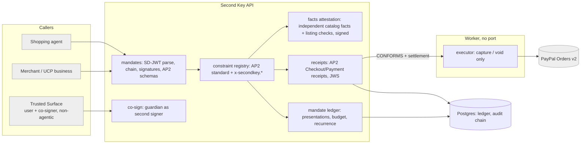

# Second Key: from hackathon app to payment-authorization infrastructure

Date: 2 November 2026. Submission deadline: 12 November, 12:00 PT (about 9.5 days).

**Labels used throughout:**
- **[V]** verified from a primary source in this investigation (linked in §11);
- **[R]** verified in this repository;
- **[I]** my technical interpretation;
- **[H]** hypothesis, needing evidence;
- **[S]** speculative, long-term.

---

## 0. The answer in one page

**Should Second Key implement AP2? Yes.** Treating it as a constraint was wrong.
- AP2 v0.2 is a concrete, open, SD-JWT-based mandate format with a written verification procedure [V].
- It names an extension point made for exactly what we do: new **mandate constraint types**, each with a schema and an evaluation algorithm [V].
- It lets any role **delegate its verification to a technology provider** [V].

Second Key can be a real AP2 participant: a **delegated verifier** that issues signed AP2 receipts. A mock that sounds like AP2 would not count.

**What AP2 leaves open, and Second Key should own:** *intent conformance and settlement integrity for delegated payments.*
- AP2 and Mastercard's Verifiable Intent bound the damage of a manipulated agent to what the mandate's constraints allow [V]. Their enforceable constraints are merchant, exact item IDs, amount, payee, instrument, dates, budget and recurrence [V].
- Verifiable Intent says outright that descriptive fields ("product name, brand, color, size") are informational and not enforced [V]. AP2 requires every validation to be deterministic code [V].
- So **"size 10, not white, actually a trail shoe, not a replica, not double the market price"** is enforced by nobody. That gap between what the user meant and what the mandate machine-checks is exactly what our existing engine already does well [R]:
  - independent product facts;
  - listing-integrity checks;
  - a three-way match against PayPal's stored order before capture.
- Two more gaps AP2 doesn't own:
  - its **stateful** constraints (budget, recurrence, no double use of an open mandate) need a ledger, and the spec doesn't say who keeps it [V];
  - nothing in AP2 checks that **what the PSP actually settles** matches the closed mandate. That check is left to the processor [V].

**The single most differentiated capability:** *attested intent conformance*. It has three parts:
- **A new AP2 constraint type** (`x-secondkey.item_attributes.1`). It expresses the user's descriptive intent as structured attribute requirements.
- **A deterministic evaluator** over a **product-facts attestation** that Second Key signs after fetching facts independently. AI only extracts facts from messy listings, and can only add "can't confirm"; it never decides.
- **A signed conformance receipt** that merchants, processors and later dispute reviewers can verify without trusting our database.

Paired with what we already have (settlement binding to PayPal's stored order, and a human co-signer), the line becomes: **"AP2 proves your agent was authorized. Second Key proves it bought what you meant, and that PayPal charged exactly that."**

**Why we are not infrastructure yet** (detail in §4):
- Our approvals live in our database, so nobody else can verify them.
- We invented our own intent format instead of meeting the ecosystem's.
- We sit in the money path as a merchant of record.
- We split attention between two problems.
- We have no interoperability proof and no developer path.

**What we can honestly demonstrate by 12 November** (plan in §8):
- Real AP2 v0.2 SD-JWT mandates: user-signed open mandates from a non-agentic Trusted Surface (WebCrypto in the browser), agent-signed closed mandates, and a merchant-signed checkout.
- Second Key verifying the chain, enforcing the standard constraints plus ours, keeping the stateful ledger, issuing signed receipts, and binding settlement to a real PayPal sandbox Orders v2 authorization and capture.
- Five attacks caught, each at a different, explainable step.
- An interoperability gate: mandates built by Google's reference AP2 Python SDK must verify in our TypeScript verifier. **If that gate fails, we say "schema-compatible, interop pending"**, not "AP2-compatible".

**Business wedge [H]:** PSPs and merchant platforms that accept agent checkouts.
- AP2 requires them to verify mandates [V], and they carry the disputes.
- We sell delegated verification and conformance receipts used as dispute evidence.
- Expansion: wallets (a cross-merchant budget ledger), then enterprise procurement (co-signature).

**The decision I need from you:** whether to spend the remaining days on this AP2 core (§8, Horizon 1), with the polish pass cut to the hero, mobile basics and video. I recommend yes.

---

## 1. AP2 as it actually is (v0.2, primary sources)

### What it is and who owns it [V]
- An open protocol for agent payments, introduced by Google on 16 September 2025 with partners including PayPal, which published its support the same day.
- **v0.2 was released on 28 April 2026**, alongside Google **donating AP2 to the FIDO Alliance**. Standardization continues in FIDO's Agentic Authentication and Payments technical working groups.
- AP2 is "a security feature within a Commerce Protocol". Catalog and checkout APIs are out of scope, and it is designed to plug into Google's **Universal Commerce Protocol (UCP)**.

### Roles [V]
- **Shopping Agent:** assumed agentic, and therefore a potential attacker.
- **Credential Provider**, **Merchant** and **Merchant Payment Processor:** each may be agentic or not.
- **Trusted Surface:** MUST be non-agentic. It obtains informed user consent and creates user-signed mandates.
- One entity may play several roles, and **any role may delegate its verification responsibilities to a technology provider**.

### Mandates [V]
They are SD-JWT verifiable credentials (RFC 9901), with delegation chains following `draft-gco-oauth-delegate-sd-jwt`.

| Mandate | `vct` | Binds to | Verified by |
|---|---|---|---|
| Open Checkout | `mandate.checkout.open.1` | Constraints and the agent key (`cnf.jwk`) | Merchant (constraints) |
| Closed Checkout | `mandate.checkout.1` | `checkout_hash` = hash of the **merchant-signed** `checkout_jwt` | Merchant |
| Open Payment | `mandate.payment.open.1` | Constraints and the agent key | Credential Provider, Network |
| Closed Payment | `mandate.payment.1` | `transaction_id` = hash of `checkout_jwt`; `payee`; `payment_amount` (minor units); `payment_instrument`; optional `risk_data` | Credential Provider, Network, Processor |

**Receipts:** the Checkout Receipt and Payment Receipt carry `status`, `iss`, `iat`, a `reference` (hash of the closed mandate), an error code, and an `order_id` or `payment_id`/`psp_confirmation_id`.

**Modes:**
- **Human present:** the user signs the closed mandates.
- **Human not present:** the user signs open mandates; the agent signs closed mandates with the key bound in `cnf`.
- In both cases, verifiers always receive closed mandates.

**Standard constraints:**
- `checkout.allowed_merchants`;
- `checkout.line_items`: an exact list of item IDs, evaluated as a max-flow problem;
- `payment.allowed_payees`, `payment.allowed_payment_instruments`, `payment.allowed_pisps`;
- `payment.amount_range`;
- `payment.budget` and `payment.agent_recurrence`: both **require tracking previous presentations**;
- `payment.reference`, `payment.execution_date`.

**Extension point:** a new constraint must define "a uniquely defined type, a schema (including which fields are selectively disclosable), the evaluation algorithm".

### What AP2 guarantees [V], and what it doesn't [I]

**It guarantees:**
- The merchant can prove the agent was authorized for this exact signed checkout.
- The processor and credential provider can prove the payment was authorized for this checkout and amount.
- Stolen or reused mandates fail through hash binding, `sd_hash` and the agent key.
- Disputes get a non-repudiable chain of what each party saw.
- With a manipulated agent, "the worst-case financial and logical impacts are strictly bounded" by the constraints.

**It explicitly assumes:** "preventing prompt injection attacks is infeasible".

**It does not guarantee [I, from the spec's scope statements]:**
1. **That the constraints say what the user meant.** "The Checkout and Payment Mandate contents are assembled by the Shopping Agent". The agent, a potential attacker, drafts the constraints the user then signs. If the user signs an agent-drafted "any item in category X under $1,200", AP2 enforces exactly that, and nothing more specific.
2. **Descriptive intent.** Line items are matched by ID; there is no attribute vocabulary. Verifiable Intent states that descriptive fields are "informational context" [V]. In autonomous mode with category-level intent, item IDs can't be listed in advance, so enforcement falls back to merchant, amount and payee.
3. **Who keeps the state** for budget, recurrence and the "don't present a second open mandate" rule. The double-spend mitigation depends partly on "the non-deterministic portion of the Shopping Agent", and verifiers MAY reject overlaps [V]. No single merchant can enforce a budget that spans merchants.
4. **That settlement matches the mandate.** The processor must check the payment credential is "appropriately scoped". Nothing in AP2 re-reads what the PSP actually stored or captured.
5. **Agent-to-agent delegation and dispute retrieval**: both "outside the scope of the current specification" [V].
6. **Human co-authorization:** one user signature per mandate. There's no notion of a second required signer.

### Maturity [V]
- **Version:** v0.2.0 on GitHub (`google-agentic-commerce/AP2`).
- **SDK:** Python, models and canonical JSON schemas in `code/sdk/python/ap2/`. "A PyPI package will be published at a later time"; install from git.
- **Samples:** Python (ADK + Gemini), Go and Android.
- **In production:** nothing listed by Google as production-ready.
- **PayPal's live agentic product, Agent Ready** (docs updated 13 Oct 2026), supports **ACP** (ChatGPT, delegated tokens via Braintree) and **UCP** (Google AI Mode and Gemini, including through **PayPal Orders v2**). AP2 is not one of its listed paths. UCP declares itself "fully compatible" with AP2: businesses advertise the AP2 extension, sign the checkout state, and verify the mandates the platform submits to `/complete`.
- **Related draft:** Mastercard's **Verifiable Intent** (draft v0.1, March 2026) is a layered SD-JWT delegation chain (credential provider → user → agent) that Google calls AP2-compatible.

### Feasibility: the eight questions

| # | Question | Answer |
|---|---|---|
| 1 | Implement AP2 directly? | **Yes, as verifier and receipt issuer.** In TypeScript: SD-JWT parsing and disclosure hashing (RFC 9901), the KB-JWT and delegate chain, ES256 via `jose`, schema validation against AP2's canonical JSON schemas, and the standard constraint evaluators. About 2 days for a careful engineer [I]. |
| 2 | AP2-compatible integration? | Yes, if an **interop test** passes: tokens from Google's Python SDK verify in our verifier, and ours parse in theirs. Without it we may only say "built to the v0.2 schemas". |
| 3 | Participate in the lifecycle? | Yes: as the **delegated verifier for the Merchant and Processor roles** (spec-sanctioned), and as a **Trusted Surface** for the co-signer. Not as the Shopping Agent or the Credential Provider for real cards. |
| 4 | Independent policy layer around AP2? | Yes, through **custom constraint types**, which travel inside the user-signed open mandate, so the user's signature covers them. |
| 5 | Protection before execution? | Yes. Closed mandates are verified before the credential is released or the capture runs, and with PayPal Orders v2 AUTHORIZE we control capture [R]. |
| 6 | Proposed action consistent with intent? | For machine-checkable fields, AP2 already does this. For descriptive intent, **only with an attribute constraint plus independently attested facts.** That is our contribution. |
| 7 | Detect instructions that emerge after authorization? | Partly. The mandate bounds the action whatever the agent read. We add evidence: an injection check on the pages the agent bought from [R], reported as `risk_data`, never as the decision. |
| 8 | Complementary infrastructure? | Yes: a delegated verifier, conformance attestor and stateful ledger. That's a role AP2 creates, rather than a rival protocol. |

**The smallest meaningful AP2 implementation** (Horizon 1, §8): verify human-not-present closed Checkout and Payment Mandates chained to user-signed open mandates, with the standard constraints and one custom constraint, and return signed Checkout and Payment Receipts. Tie settlement to a real PayPal sandbox order, and include the Python-SDK interop test. Anything less, such as JSON objects named after AP2, would be a mock.

---

## 2. The landscape: what is solved and what isn't

| Actor | What they provide | Status |
|---|---|---|
| Google AP2 / UCP | Mandates and receipts; the checkout protocol | v0.2, FIDO standards track [V] |
| Mastercard Verifiable Intent / Agent Pay | Layered SD-JWT delegation from the credential provider; machine-enforced amount, payee and merchant; descriptive fields informational | Draft v0.1 [V] |
| Visa Trusted Agent Protocol | Agent identity and authorization through RFC 9421 HTTP message signatures, aligned with Web Bot Auth | Open repo and spec [V] |
| IETF Web Bot Auth | Agent-operator identity (who sent the request), not purchase authority | Draft [V via spec references] |
| OpenAI / Stripe ACP | Delegated payment tokens scoped by `allowance` (one-time, `max_amount`, currency, merchant, expiry) | Draft RFC, beta [V] |
| PayPal Agent Ready | Merchant acceptance for ACP and UCP via Braintree or Orders v2 | Live docs [V] |
| AVA Pay (community) | Merchant-side gateway verifying TAP, AP2 v0.2 and Web Bot Auth, with an agent directory; listed on Shopify | Self-described, unverified [V repo; claims unverified] |

### AVA Pay, inspected (2 Nov 2026)

**What it is:** a Shopify app that checks AI agents visiting a store and decides what verified agents "earn". Sources: the [App Store listing](https://apps.shopify.com/ava-pay) [V], plus screenshots supplied by the user of the app running in a demo store.

**Listing facts [V]:** launched 15 September 2026; free; 0 reviews; categorised as Fraud → Bots, Identity verification; "works with Google AP2, Visa Trusted Agent Protocol, Web Bot Auth". It reads device and activity data, and edits orders, discounts and the Online Store.

**What the screenshots show:**
- **Settings.** A master switch to accept verified agents. A default discount (15%) and a cap (20%). A separate discount for identity-only agents (Web Bot Auth with no buyer mandate). A no-code theme app embed. A "Send test agent visit" button that signs a demo credential, verifies it and records it as a test.
- **Policies.** Per-platform rules (platform, Allow, max discount, max mandate spend, offer discount for mandate-backed agents only). Unknown agents get the most restrictive rule. The policy exports and imports as JSON.
- **Storefront.** A toast: "This AI agent visit was verified. Discount code … was applied by this store's policy."
- **Traffic.** Requests, verified, rejected, agent revenue. A per-platform and per-protocol table. Outcomes including "AVA Pay unreachable (failed closed)". Failure reasons (`signature_expired`). Discounts minted.

**My reading [I]:**
- **Where it acts:** at the **storefront door**, when the visit happens. It answers *who is this agent* and *does it carry a mandate*, and turns the answer into an incentive (a discount).
- **What it doesn't show:** what the agent puts in the cart, whether that matches the buyer's intent, what is paid, or what is settled. So it's not competing for the till.
- **Evidence of real traffic:** all traffic in the screenshots is the vendor's own demo agent (`agent_demo_public` over the vendor's own `ava-tap` profile), with $0 agent revenue. No real AP2 or Visa TAP traffic is evidenced there.

**What it does well, and what we should copy:**
1. **A no-code install with a self-check button.** A "Send test agent visit" moment proves the whole path in one click. Our equivalent is **"Run a test verification"** on `/developers`: sign sample AP2 mandates in the browser, have Second Key verify them, and show the signed receipt with an in-browser JWKS check.
2. **A reason code on every verdict, and fail-closed as a counted outcome.** We have the reasons; make them stable machine codes in receipts (the RFC 9457 types in §5).
3. **Portable policy JSON.** Export and import our constraint templates (the open-mandate constraints plus `x-secondkey.*`) as versioned JSON.
4. **Honest layering.** It shows identity-only and mandate-backed traffic separately. We should state our layer just as plainly (see the hero below).
5. **Merchant-positive framing** ("decide what verified agents earn"), not only fraud. Our merchant value is fewer "that's not what I asked for" disputes and settlement proof. Keep it measurable, and don't promise revenue.

**Where Second Key goes further, by design:**
- product-level conformance to intent;
- binding settlement to PayPal's stored order and capture (live on sandbox [R]);
- signed receipts any party can verify;
- a human co-signer.

**Where we're no better yet:** we also have only synthetic traffic, and no install path for a real store.

**Positioning consequence:** we sit beside door-level gateways like this one, not against them. The stack is a **trust ladder** in four layers:

| Layer | Question | Who answers it |
|---|---|---|
| Identity | *Who is this agent?* | Web Bot Auth / TAP / AVA Pay |
| Authority | *How much may it spend, where?* | AP2 / Verifiable Intent |
| **Conformance** | *Is this cart what the person meant?* | **Second Key** |
| **Settlement** | *Did the PSP charge exactly that?* | **Second Key** |

**What is converging:** cryptographic proof that a signed delegation exists, scoped by amount, payee and merchant, plus agent identity. Big players own this, and community gateways already verify it. **Competing on signature verification alone is not a business.** It's the table stakes we must meet.

**What remains unsolved, and is real:**

| Problem | Who has it | Existing | Unsolved part | Can Second Key solve it? |
|---|---|---|---|---|
| A. Descriptive intent isn't enforced | Users, merchants (disputes), issuers | Exact item IDs; informational fields | Category-level delegation ("a laptop ≤ $1,200, new, 16 GB") is unchecked beyond amount and merchant | **Yes, core.** Attribute constraint + facts attestation + deterministic evaluator. Built on existing catalog, listing-integrity and checks [R] |
| B. Constraints drafted by the attacker | Users | Trusted Surface shows content | The user signs an agent-drafted, possibly over-broad mandate | **Yes, partly.** Compile intent with ambiguities held [R]; show the "worst thing this mandate allows" before signing (§7, opportunity 7) |
| C. Stateful limits across verifiers | Credential providers, users | Spec requires tracking; owner unspecified | Budget, recurrence and single-use across merchants | **Yes.** A neutral mandate ledger keyed by the open-mandate digest |
| D. Settlement differs from the mandate | Users, merchants, PSPs | Processor "scoping" check | PSP-stored order or capture differs (cart swap, amount drift, payee swap) | **Yes, proven [R]** on PayPal Orders v2 (three-way match, live sandbox evidence) |
| E. High-risk delegations need dual control | Enterprises, older users, families | One signer per mandate | Two-person rule for agent spending | **Yes.** A co-signature constraint; our guardian system is already built [R] |
| F. Runtime tool abuse | Agent platforms | Prompt-injection research; agent firewalls | Pre-checking each payment-relevant tool call | Partly, as an MCP/tool wrapper. Crowded; not our moat |
| G. Agent identity | Merchants | TAP, Web Bot Auth, VI | — | Don't build. Consume it |

---

## 3. What frontier payment-authorization infrastructure means here

**Principle:** infrastructure emits **verifiable artifacts** that other parties check without trusting us, and it **meets existing protocols** rather than replacing them. It enforces at the point that controls money, and states plainly where it can't.

| Capability | Decision for Second Key |
|---|---|
| A. Intent integrity | User intent becomes an **AP2 open mandate plus our attribute constraint**, compiled by AI with **ambiguities forcing a question**, never a silent default [R: intent compiler with ambiguities]. The user signs on a non-agentic Trusted Surface. |
| B. Agent identity and delegation | **Consume, don't invent.** The agent key comes from `cnf.jwk`. Optionally verify Web Bot Auth/TAP signatures (Horizon 2). No proprietary identity system. |
| C. Transaction integrity | Already strong in our database [R]. **Make it cryptographic:** signed receipts bound to `checkout_hash`, the closed-mandate hash and the PayPal order or capture ID. Single-use through the ledger; ES256 for signing. |
| D. Runtime protection | **Honest scope:** we protect the payment decision, not the agent's whole run. Horizon 2: an MCP tool wrapper that pre-checks proposed carts against the open mandate. |
| E. Evidence and audit | Keep the hash-chained log [R]. Add signed receipts and a **dispute bundle** (mandates + receipts + conformance attestation + PayPal IDs). Retain hashes and minimal disclosures, not full conversations. |
| F. Escalation | Four outcomes: **conforms** (proceed); **nonconforming** (refuse with a signed error receipt); **can't confirm** (escalate to the principal, or to a co-signer if the mandate requires one); **co-sign required** (a policy-defined two-person rule). AI observations never decide; they only feed "can't confirm". |

---

## 4. Gap analysis against the repository [R]

| Capability | Current state | Gap | Engineering required |
|---|---|---|---|
| User intent representation | **Implemented (own format).** `PolicyV1`/`TransferPolicyV1` (Zod), compiled from text with ambiguities, confirmed, frozen, sha-256 digested | Not an AP2 credential; unsigned; no selective disclosure | Map to the AP2 open-mandate schema plus our constraint; user signature on a Trusted Surface |
| Agent identity | **Absent.** An API key per `agent:*` principal | No key, no `cnf` binding, no TAP/Web Bot Auth | Agent key from `cnf`; Web Bot Auth verification later |
| Delegated authorization | **Partial.** Confirmed intent with expiry and `max_purchases`; payer guardian (ADR-0020) | No delegation chain; one agent per intent | AP2 open → closed chain; ledger for single use |
| Transaction integrity | **Implemented, strong.** Single-use approval bound to cart and policy digests; three-way match on PayPal's stored order; deterministic request IDs | Not cryptographically signed; not verifiable outside us | Signed receipts; bind to `checkout_hash` |
| Runtime protection | **Partial.** Injection check on the purchased listing; reference agent has only our tools | No per-step gating | MCP wrapper (Horizon 2) |
| AP2 compatibility | **Absent** (AP2-shaped ideas only) | Everything in §1 | Verifier, receipts, interop test |
| Policy enforcement | **Implemented, narrow.** Fixed checks; payer profile with delayed loosening; evidence-based policy (ADR-0021) | No policy-as-code; per-tenant policies hard-wired | Constraint registry (type → schema → evaluator), versioned |
| Evidence provenance | **Implemented.** Hash-chained audit, grounded quotes, model and prompt version per check | Unsigned; no export format | Signed attestations; dispute bundle |
| Cryptographic approvals | **Absent.** Database capabilities; guardian credential is a hashed bearer token | No signatures | ES256 receipts; co-signer signs with a WebCrypto key |
| Developer SDK | **Absent.** OpenAPI + Postman; agent tools internal | No package | `@secondkey/ap2` TS (verify, build test mandates); an MCP server later |
| Payment integrations | **Implemented, sandbox.** PayPal Orders v2 AUTHORIZE with vault, capture, void, Payouts, webhooks, disputes | No ACP, UCP or Agent Ready | Settlement binding in front of Orders v2; UCP `/complete` adapter (Horizon 2) |
| Outbound webhooks | **Absent** (inbound PayPal only) | — | Signed events (Horizon 2) |

**Why Second Key is not yet frontier infrastructure:**
1. **Its trust can't be checked from outside.** Every guarantee lives in our Postgres, and infrastructure must hand out proofs. This is the root cause.
2. **It is application-shaped.** Our own intent schema, our own endpoints, our own consumer pages. Nobody integrates with a worldview; they integrate with the protocols they already speak.
3. **It is in the money path as a merchant of record.** Adopting us means changing settlement, which no PSP or merchant will do for a verifier.
4. **It has two theses.** Human scam calls and agent mandates share an engine but not a buyer. The human lane is a consumer UX on rails we can't intercept (as the earlier review found).
5. **The AI is the story; the guarantee should be.** Judges and buyers remember "AI detects manipulation", which is the least defensible part.
6. **There is no interoperability proof** with any external format, and **no developer path under an hour**.

---

## 5. How a developer integrates (target design)

**Enforcement reality:** Second Key can't stop someone who holds the money and ignores us. It guarantees only where:
- **(a)** it holds capture authority, as on PayPal Orders v2 AUTHORIZE, where our executor captures [R]; or
- **(b)** a verifier that holds money (credential provider, PSP, merchant) **requires a valid Second Key receipt** before releasing a credential or capturing.

Every surface states which of the two applies.

**Contract (v2, sketch):**
```http
POST /v2/verifications            # Merchant or processor delegate; Idempotency-Key required
Authorization: Bearer sk_test_…   # per-tenant key; sandbox and live keys never share a tenant
{
  "checkout_mandate": "<SD-JWT chain: open (user-signed) ~ closed (agent-signed)>",
  "payment_mandate":  "<SD-JWT chain>",
  "checkout_jwt":     "<merchant-signed JWT>",
  "evidence":         { "pages_read": ["…"], "conversation": null }   // optional; can only add "can't confirm"
}
→ 200 {
  "verification_id": "ver_…",
  "decision": "CONFORMS" | "NONCONFORMING" | "CANNOT_CONFIRM" | "COSIGN_REQUIRED",
  "constraints": [ { "type": "checkout.line_items", "result": "pass" },
                   { "type": "x-secondkey.item_attributes.1", "result": "fail",
                     "detail": "color: 'Cloud White' is excluded", "attestation": "<JWS>" } ],
  "checkout_receipt": "<JWS>", "payment_receipt": "<JWS | null>",   // AP2 receipt schemas
  "ledger": { "open_mandate": "<digest>", "presentations": 1, "budget_remaining": 41600 }
}

POST /v2/settlements              # binds a CONFORMS verification to a PSP order before capture
{ "verification_id": "ver_…", "psp": "paypal", "order_id": "5O190127TN364715T" }
→ re-reads the PayPal order; items, amount, currency and payee must match checkout_hash → capture via executor
→ Payment Receipt with psp_confirmation_id = PayPal capture id

GET  /.well-known/jwks.json        # receipt and attestation keys; rotated, kid-addressed
```

**The rest of the contract:**
- **Errors** follow RFC 9457 problem types (`mandate.signature_invalid`, `mandate.expired`, `ledger.open_mandate_reused`, `settlement.order_mismatch`).
- **Webhooks** carry an HMAC signature and a timestamp. Event types: `verification.completed`, `cosign.required`, `cosign.granted`, `settlement.captured`, `settlement.voided`.
- **Per-tenant rate limits.**
- **Versioned paths** (`/v2`), with the `vct` versions pinned.

**SDK** (`@secondkey/ap2`, TypeScript first):
```ts
const sk = new SecondKey({ apiKey: process.env.SECOND_KEY_KEY });
const v = await sk.verify({ checkoutMandate, paymentMandate, checkoutJwt });
if (v.decision !== "CONFORMS") return reject(v.checkoutReceipt);   // signed reason for the agent
await sk.settle({ verificationId: v.id, psp: "paypal", orderId });
```

**Under an hour:**
1. Install the SDK and get a sandbox key.
2. Use `sk.testing.mandates()` to create a test user key, agent key and merchant key, and sign sample mandates.
3. Call `verify`, then `settle` against your PayPal sandbox order.
4. Verify the receipt with our JWKS.

A **conformance kit** of signed AP2 test vectors, each with its expected decision, is the "it works" moment.

---

## 6. Architecture

**Shape:** a modular monolith, not microservices. Keep the Fastify API, the isolated worker (the only money mover [R]) and Postgres. Add these modules:



**Trust boundaries:**
1. The agent is untrusted, per AP2's own threat model.
2. The merchant is trusted only through its signature on `checkout_jwt`.
3. Product facts are trusted only from our independent fetch, signed by us.
4. AI output is untrusted and can only yield `CANNOT_CONFIRM`.
5. Only the worker moves money.
6. Receipt-signing keys live in KMS in production; locally they're env-held for the demo, and we say so.

**Sequence: a nonconforming agent purchase** (the demo's key moment):
```mermaid
sequenceDiagram
  participant U as Rose (Trusted Surface)
  participant A as Shopping agent
  participant M as Merchant
  participant K as Second Key
  participant P as PayPal
  U->>A: open Checkout + Payment Mandates (user-signed; cnf = agent key; constraints incl. x-secondkey.item_attributes)
  A->>M: build checkout
  M-->>A: merchant-signed checkout_jwt (white shoe, $84)
  A->>K: closed mandates (agent-signed) + checkout_jwt
  K->>K: signatures + chain OK · line_items OK · amount OK · ledger OK
  K->>K: facts attestation: color = "Cloud White" → item_attributes FAIL (deterministic)
  K-->>A: Checkout Receipt (Error, signed) · no credential released, no PayPal call
```
**The other outcomes:**
- **Success:** every constraint passes, so the authorization is created and verified against PayPal's order, captured, and a signed Payment Receipt is returned with the capture ID.
- **Unauthorized:** a closed mandate signed by a key other than `cnf`, or an open mandate presented a second time, is rejected before any constraint runs.

**Failure modes and recovery:**

| Failure | What happens |
|---|---|
| Facts source down | `CANNOT_CONFIRM`; escalate, never pass |
| PayPal unreachable after authorization | Existing reconcile path [R] |
| Signing key unavailable | Fail closed |
| Ledger race | Row lock on the open-mandate digest |
| Merchant `checkout_jwt` changed after the mandate | Hash mismatch, so the mandate is refused |

---

## 7. Differentiated opportunities, scored

Scores run 1–5; most ideas do not score high.

| # | Opportunity | Novelty | Depth | Relevance | Adoption | Defensible | Demo | Feasible now | Moat or feature? |
|---|---|---|---|---|---|---|---|---|---|
| 1 | **Attested intent conformance**: attribute constraint + signed facts + deterministic evaluator | 4 | 4 | 5 | 3 | 4 | 5 | 3 | **Moat candidate:** fact attestation plus an evaluated catalog builds over time |
| 2 | **Mandate-to-settlement binding**: closed mandate ↔ PayPal stored order ↔ capture | 3 | 3 | 5 | 4 | 2 | 5 | 5 | Feature (PSPs can build it), but proven and judge-friendly |
| 3 | **Neutral mandate ledger**: budget, recurrence, single use across merchants | 3 | 3 | 4 | 3 | 3 | 3 | 4 | Network-effect moat only at scale |
| 4 | **Co-signature constraint**: a two-person rule on agent mandates (guardian as second signer) | 4 | 3 | 3 | 3 | 2 | 5 | 4 | Feature; strong for procurement and families |
| 5 | Runtime MCP tool gate | 2 | 3 | 4 | 4 | 1 | 3 | 3 | Feature, crowded |
| 6 | Manipulation signals in `risk_data` | 3 | 2 | 3 | 2 | 1 | 3 | 5 | Feature |
| 7 | **Mandate preview**: before signing, show the worst purchases the drafted mandate would *also* allow, searched in the catalog | 5 | 4 | 4 | 3 | 3 | 5 | 2 | Moat with #1: makes over-broad delegation visible |

**The one to build:** #1, delivered together with #2 and #4. We already own most of the parts, and the three together make a single demo where four constraints are each caught at a different, explainable step. #7 is the most original idea, but too much for this week; it's the first Horizon 2 item.

---

## 8. What to build: three horizons

### Horizon 1: hackathon (by 11 November, one day of buffer)

**Cut:** the AG Studio "mind-blowing" brainstorm becomes a single idea (below); no ACP/UCP; no new consumer features; the human transfer flow stays as is.

| Day | Deliverable | Acceptance and tests |
|---|---|---|
| 3 Nov | `packages/ap2`: SD-JWT (RFC 9901) parse and verify, disclosure digests, KB-JWT, delegate chain; ES256 with `jose`; validation against AP2's canonical JSON schemas (vendored, with the version recorded) | The spec's example tokens parse and their digests and `checkout_hash` recompute; unit tests for tampering of every field |
| 4 Nov | **Interop gate:** build mandates with Google's Python SDK (pinned commit) and commit them as test vectors with their public keys | Our verifier accepts them and rejects the tampered variants. **If this fails, the claim becomes "built to v0.2 schemas, interop pending"** |
| 5 Nov | Standard constraint evaluators (allowed merchants, line items via max-flow, amount range, allowed payees, budget, reference); **mandate ledger** (single use, budget); signed **Checkout/Payment Receipts**; JWKS | Property tests for max-flow; a second open-mandate presentation is rejected; cross-merchant budget enforced; receipts verify with the JWKS |
| 6 Nov | **`x-secondkey.item_attributes.1`** (schema, selectively disclosable fields, deterministic evaluation over a signed facts attestation built from catalog facts and listing checks [R]); **`x-secondkey.cosign.1`** (closed mandate needs a co-signer JWS when the condition holds; guardian UI signs with a WebCrypto key) | AI failure → `CANNOT_CONFIRM`, never pass; co-sign by any key except the enrolled one → refused |
| 7 Nov | **Settlement binding** on PayPal sandbox Orders v2: the merchant-signed checkout drives the order; three-way match against `checkout_hash` before capture [R]; Payment Receipt carries the PayPal capture ID | Live sandbox run, all four outcomes, with PayPal IDs recorded in `docs/evidence/` |
| 8 Nov | Agent demo rebuilt on real mandates. Rose signs the open mandate in the browser (Trusted Surface, WebCrypto). Five runs: conforms; steered off the line items; **AP2-valid but the wrong product** (white shoe); cart swap at PayPal; open mandate reused. Each shows *which party's check caught it*, with the receipt viewable | Browser test at desktop and 390 px |
| 9 Nov | Positioning and hero (below; the trust ladder from §2), mobile pass, `/developers` quickstart with the conformance kit and a one-click **"Run a test verification"** (sign sample mandates in the browser, verify, show the signed receipt and its JWKS check: lesson from AVA Pay's self-check), exportable constraint templates as JSON, Desk lens on mandates | Lighthouse a11y ≥ 90 on home; no horizontal scroll at 360/390/414/768; the test verification works with no account and no key |
| 10 Nov | Video (under 3 minutes) and Devpost text; README; ADR-0023 (AP2 verifier) | Every claim in the video maps to a test or a sandbox record |
| 11 Nov | Buffer; submit | — |

**Risks:**
- The SD-JWT delegate chain format (`draft-gco-oauth-delegate-sd-jwt`) is newer than most libraries. Mitigation: implement the minimal parts ourselves against the spec's own examples.
- The interop gate may fail. Mitigation: say so plainly.

### Horizon 2: developer infrastructure (3–6 months) [I]
- Stable `/v2` and the TypeScript and Python SDKs.
- Sandbox tenants and a conformance kit.
- Signed webhooks.
- A constraint registry, versioned per tenant.
- The **mandate preview** (#7).
- A UCP business adapter (`/complete` verification for PayPal Orders v2 merchants, Agent Ready-adjacent).
- Web Bot Auth/TAP identity verification.
- Mastercard Verifiable Intent chain support.
- KMS-held keys, SOC 2 groundwork, a load-tested ledger, and an external security review of the verifier.

### Horizon 3: frontier (1–3 years) [S]
- Our attribute-constraint vocabulary and fact attestation proposed to the FIDO payments working group.
- A neutral cross-PSP mandate ledger.
- Agent-to-agent delegation once AP2 defines it.
- Attested product facts as a network (merchants co-sign facts).

**Science fiction, for now:** a universal agent reputation; real-time intent inference without user signatures.

---

## 9. Business [H unless marked]

- **Initial buyer:** PSPs and merchant platforms accepting agent checkouts (UCP/AP2, ACP), plus agent platforms acting as merchant of record.
  - **Pain:** AP2 obliges merchants and processors to verify mandates [V]; agent transactions raise dispute ambiguity (VI's stated motivation [V]); and descriptive mismatch is what a user disputes ("that's not what I asked for").
  - **Product:** delegated verification + conformance receipts as dispute evidence + settlement binding.
  - **Model:** a fee per verification, with a dispute-evidence tier.
- **Alternatives:** building it in-house; network programmes (Visa, Mastercard); gateways (AVA Pay).
- **Why us:** independent facts plus semantic conformance plus settlement proof, which signature-only gateways don't do.
- **Barriers:** PSP security reviews; key custody; proving accuracy (published conformance evaluation needed); the market's maturity (most agent checkout volume is still early).
- **Expansion:** wallets and credential providers (the ledger); enterprise procurement (the co-signer two-person rule); the consumer guardian (the existing human lane) as a wallet feature, not a standalone app.
- **Not:** a fraud dashboard; an agent framework; a new protocol.

---

## 10. The pre-demo pass, reframed by this strategy

### Hero: three directions

| | Headline | Subline | Visual |
|---|---|---|---|
| **A (recommended)** | **Your agent was authorized. Was it right?** | AP2 proves an agent may pay. Second Key proves it bought what you meant, and that PayPal charged exactly that. Signed receipts, before money moves. | The **trust ladder** (identity → authority → conformance → settlement), with Second Key owning the last two rungs. Under it, a live run fails at the conformance rung in red, its signed receipt beside it. |
| B | The second key for autonomous payments | Agents and people both get manipulated. Second Key verifies every delegated payment against what was actually meant, and asks a second person when it can't be sure. | Split screen: Rose and her agent, one shared decision rail. |
| C | Bounded isn't enough | Protocols cap how much an agent can spend. Second Key checks whether it spent it on the right thing. | A conformance receipt unfolding, field by field. |

**A** leads with the gap AP2 leaves, uses the judges' own vocabulary (PayPal is an AP2 partner [V]), and points at the demo's best moment. The human lane moves to a second section: "The same second key, for people under pressure."

### Visual direction (one paragraph)
- **Type:** Geist for UI and Newsreader for statements, kept.
- **Colour:** paper/ink/evergreen, plus one alert colour (brick) reserved for "money stopped".
- **Motion:** only for state the backend reports; nothing loops or pulses unless it is waiting on a real event.
- **Live vs demo:** "Live · PayPal sandbox" on anything read from PayPal; "Synthetic" on people and pages; signed artifacts get a "Verify" button that checks the JWS in the browser against our JWKS.
- **Copy:** at most two sentences per block.

### Mobile approach
- Test at 360/390/414/768 px and desktop.
- The two-window demo becomes a single-screen **"Rose | Sarah" toggle** on narrow screens (still separate sessions).
- AG Studio Insights gets a designed "best on desktop" card with three key figures.

### AG Studio: one idea, done well
**A "Mandate investigation" workspace.** Rows are verifications. A custom **conformance-receipt widget** renders the signed receipt constraint by constraint and verifies its signature live. The Studio agent explains a nonconforming decision from the receipt and drafts the dispute-evidence summary, read-only.

It beats the other ideas on judge impact per hour: it shows custom widgets, theming and the Agent Framework on data no other entry will have (signed AP2 receipts). Other ideas are deferred: anomaly detection, rule what-ifs, a replay timeline.

### Known UX issues to fix (from earlier inspection; mobile still untested)
1. Payer setup takes four steps before a judge sees a payment. Add a "use a prepared setup" path that still enrols Sarah through her window.
2. The two-window demo depends on popups; it breaks on phones.
3. The agent demo's four long tab labels wrap on narrow screens.
4. The Developers page is dense.
5. "Live sandbox" tags appear on the local fake stack. Label them by environment.
6. The AG Studio trial watermark (needs a licence key from you).

---

## 11. Sources

- AP2 home and v0.2 notes: https://ap2-protocol.org/
- AP2 specification v0.2: https://ap2-protocol.org/ap2/specification/
- AP2 Checkout Mandate: https://ap2-protocol.org/ap2/checkout_mandate/
- AP2 Payment Mandate: https://ap2-protocol.org/ap2/payment_mandate/
- AP2 security and privacy considerations: https://ap2-protocol.org/ap2/security_and_privacy_considerations/
- AP2 repository (v0.2.0, Python SDK, samples): https://github.com/google-agentic-commerce/AP2
- Google: AP2 v0.2 and the FIDO Alliance donation (28 Apr 2026): https://blog.google/products-and-platforms/platforms/google-pay/agent-payments-protocol-fido-alliance/
- FIDO Alliance announcement: https://fidoalliance.org/fido-alliance-to-develop-standards-for-trusted-ai-agent-interactions/
- UCP and AP2: https://ucp.dev/documentation/ucp-and-ap2/
- PayPal Agent Ready overview (updated 13 Oct 2026): https://developer.paypal.com/agent-ready/overview
- PayPal on AP2 (16 Sep 2025): https://developer.paypal.com/community/blog/PayPal-Agent-Payments-Protocol/
- PayPal Agentic Commerce Services (28 Oct 2025): https://newsroom.paypal-corp.com/2025-10-28-PayPal-Launches-Agentic-Commerce-Services-to-Power-AI-Driven-Shopping
- Mastercard Verifiable Intent spec (draft v0.1): https://github.com/agent-intent/verifiable-intent/
- Mastercard on Verifiable Intent: https://www.mastercard.com/global/en/news-and-trends/stories/2026/verifiable-intent.html
- Visa Trusted Agent Protocol: https://github.com/visa/trusted-agent-protocol and https://developer.visa.com/capabilities/trusted-agent-protocol/trusted-agent-protocol-specifications/
- ACP delegated payment RFC: https://github.com/agentic-commerce-protocol/agentic-commerce-protocol/blob/main/rfcs/rfc.delegate_payment.md
- AVA Pay (community gateway; claims self-described): https://github.com/AVA-PAY/ava-pay
- AVA Pay on the Shopify App Store (launched 15 Sep 2026): https://apps.shopify.com/ava-pay
